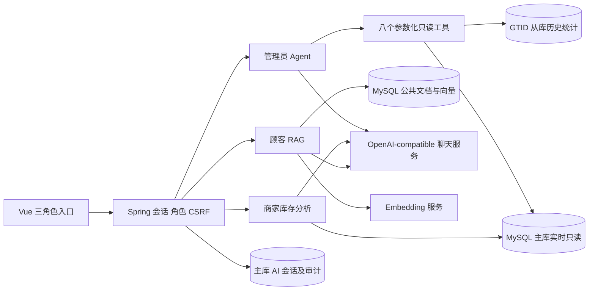

# OrderFlow V1.1 AI 架构

原交易服务仍使用原主库写连接，AI 查询使用 `of_inspect`，历史统计检查复制线程和 60 秒延迟阈值。库存以主库当前值为准。SQL 模板与参数上限由服务器确定，模型响应无法注册工具或修改数据库。模型仅接收用户输入经基础脱敏后的文本、公开知识或任务必要的聚合字段。会话访问以登录账号与当前角色匹配，商家范围由服务器会话决定。

Java 适配层只发出预定的 Chat Completions 和 Embeddings 路径，常规配置使用 HTTPS，连接 4 秒、响应 8 秒。对 429 或 503 最多重试一次。每个进程最多同时两个 AI 请求，每用户最多一个，默认 20 次模型请求尝试每分钟，全局默认 300 次每日。统计含重试与 Embedding，按主库日志计数，常规重启不会清除额度。调用日志含模型名、状态、耗时和提供商返回的 Token 数，费用取决于所配置提供商的契约和价格。

原十三表统计不包含 AI 表。AI 会话、片段、工具参数、报告与调用记录见 [AI 数据设计](DATABASE_DESIGN.md)。本地库可运行 [保留期清理 SQL](../database/ai/retention.sql)，推荐课堂验收结束后清理超过 30 天的会话和报告、90 天的调用记录。
