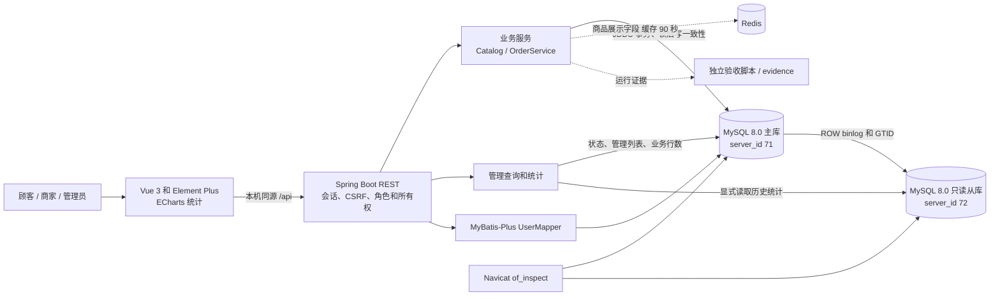
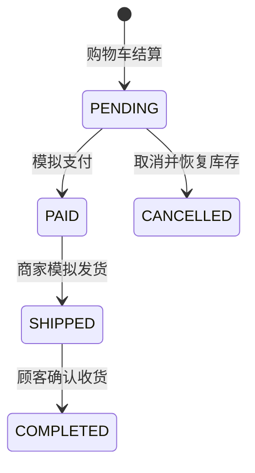

# OrderFlow 系统架构

## 组件及选型

Spring Boot 单体让登录、商品和订单可共用一次部署。MyBatis-Plus 负责账户 CRUD。业务层使用显式参数化 SQL，让锁、索引及数据源路由能对着代码演示。HikariCP 主池上限 16，从池上限 5，连接获取超时 2.5 秒。数据源绑定分别见 `DatabaseConfig.java`；主库同时供 MyBatis 和事务管理器使用，统计显式注入 `replicaJdbc`。从库拥有 `super_read_only`，连接账号只有查询、检查和只读过程权限。

商品展示缓存先在主库读取商品版本、可售状态和库存，再按版本查 Redis。商品编辑提交后删除旧键。并发读若重新填回旧版本，新的查询会计算新键；旧键由 TTL 回收。库存、订单状态和价格快照由 MySQL 事务决定。Redis 暂停时详情尝试读取主库，接口继续提供页面所需字段。

登录使用 BCrypt 和内存 HttpSession，成功登录旋转会话 ID。请求重新检查数据库中的账号状态和角色。写接口需要会话 CSRF 头。顾客订单按用户筛选，商家订单和商品按店铺筛选，管理员有平台读取和启停能力。分页游标携带最后一行的 ID，后端固定排序并限制页大小。应用只监听回环地址。

## 订单状态与边界

相同顾客的购物车变更经过用户行锁，结算按商品主键递增扣减库存。订单按商家拆分，多个订单仍属于同一次数据库事务。订单使用历史商品名称、历史成交价及收货地址快照。支付、取消、发货、收货锁定既有订单行并检查前置状态。遇到 MySQL 1213 后，下单与取消在事务之外退避重试，已经提交的转换受状态保护。

历史统计只走从库。复制中断、状态为空或报告延迟超过 60 秒时，统计返回 503，由前端提示并可刷新。状态页可同时显示主库、从库和 Redis 的可用性。主从实验通过 GTID 等待验证某次写入抵达从库。

## 后续 V1.1 扩展

可以先在只读运维说明上做 RAG，索引对象使用 README、实验手册和术语解释，每条答案保留文档引用。后续可增加固定参数的库存、订单状态和实验统计工具，由既有角色校验控制访问。评测集覆盖检索命中、引用准确、跨商家授权拒绝和日志敏感字段屏蔽。需要变更订单的流程可沿用现有服务和界面确认。V1.0 的验收范围采用规则业务与手动实验。
