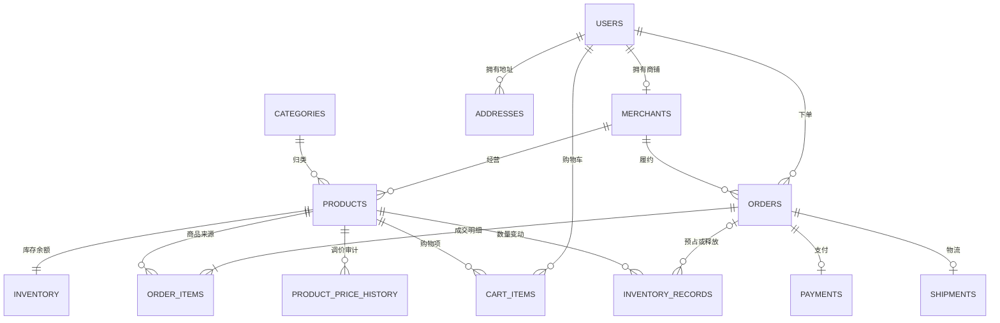
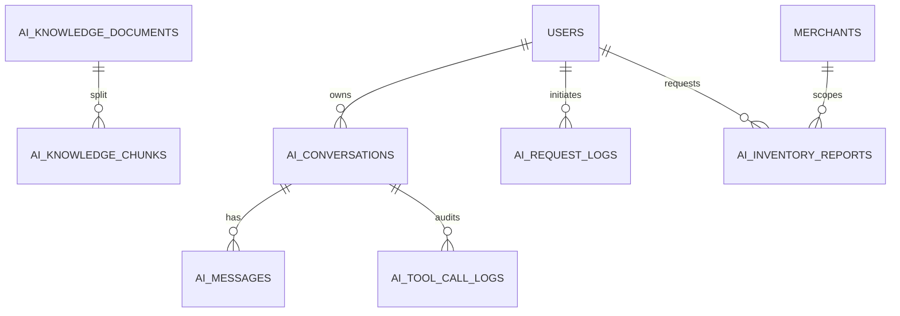

# MySQL 数据库设计

默认字符集 `utf8mb4`，排序规则 `utf8mb4_0900_ai_ci`，引擎 InnoDB，时间为 UTC。金额使用 DECIMAL。查询可用 `SHOW CREATE TABLE` 核对约束和隐式外键索引。

## 实体关系

实际外键都使用 MySQL 默认限制策略。业务上下架和账号停用通过状态字段完成。一次订单通过业务事务保证至少一个明细，库存通过商品创建事务保证有一条余额，不依赖应用之外的写入自动补全父子行。

## 数据字典

表中自增主键默认 `BIGINT UNSIGNED`。除显式标明可空的列，主要业务列均为 NOT NULL。字段的精确长度、默认值和约束以 [建表 SQL](../database/schema/001_tables.sql) 为准。

| 表 | 字段及含义 |
|---|---|
| `users` | `id` 主键，`username` 唯一登录名，`password_hash` BCrypt 或合成不可登录标记，`display_name` 显示名，`role` 枚举，`active` 启停，`created_at` 创建时间 |
| `merchants` | `id` 主键，`user_id` 唯一外键，`name` 店铺名，`active` 营业状态 |
| `categories` | `id` 主键，`name` 唯一分类名 |
| `products` | `id` 主键，`merchant_id`、`category_id` 外键，`sku` 唯一货号，`name` 品名，`price` DECIMAL(12,2) 正值，`active` 在售状态，`updated_at` 微秒级版本 |
| `inventory` | `product_id` 主键兼外键，`opening_stock` 期初余额，`available` 当前可用，两者均有非负检查 |
| `addresses` | `id` 主键，`user_id` 外键，`recipient` 收件人，`destination` 地址 |
| `cart_items` | `user_id`、`product_id` 复合主键及外键，`quantity` 为 1 至 999 |
| `orders` | `id` 主键，`user_id`、`merchant_id` 外键，`status` 状态，`total` DECIMAL(14,2) 总额，`ship_to` 收货快照，`created_at` 创建时间，`cancelled_at`、`completed_at` 随状态可空 |
| `order_items` | `id` 主键，`order_id`、`product_id` 外键且组合唯一，`product_name` 和 `unit_price` 成交快照，`quantity` 件数 |
| `payments` | `id` 主键，`order_id` 外键且唯一，`amount` 实付额，`status` 当前为 SUCCESS，`paid_at` 支付时间 |
| `shipments` | `id` 主键，`order_id` 外键且唯一，`tracking_no` 唯一模拟单号，`status` 发运状态，`shipped_at` 发货时间，`delivered_at` 可空收货时间 |
| `inventory_records` | `id` 主键，`product_id` 外键，`order_id` 外键且手工调整时可空，`reason` 枚举，`delta` 带正负符号，`created_at` 操作时间，`(order_id,product_id,reason)` 保证单次预占及释放 |
| `product_price_history` | `id` 主键，`product_id` 外键，`old_price`、`new_price` 为 DECIMAL(12,2)，`changed_at` 调价审计时间，由触发器在同一事务写入 |

## 索引与完整性

订单列表用 `(user_id,id)` 或 `(merchant_id,id)`。用户状态时间分析用 `(user_id,status,created_at,id)`。时间范围和状态聚合分别用 `(created_at,id)` 和 `(status,created_at,id)`。商品按分类在售查询用 `(category_id,active,id)`，商品名称前缀实验用单列名称索引。高频主键查找、唯一键及关联行锁使用 InnoDB 索引。

库存恒等式为 `available = opening_stock + SUM(delta)`。纯加减由业务事务写余额和流水。历史订单总额来自明细成交价乘数量，支付额与之相同。履约时间从下单到支付、发货、收货单调推进。校验 SQL 复核这些跨表规则和角色关系。顾客可在待支付状态取消，支付和取消的竞争由同一个订单主键锁串行化。

## V1.1 AI 增量 ER 图

| 表 | 数据字典 |
|---|---|
| ai_knowledge_documents | 文档主键、Markdown 正文及 SHA-256、模型名、向量空间哈希、维度、更新时间 |
| ai_knowledge_chunks | 数字 ID、父文档、文档内序号、标题、正文、网络字节序归一化双精度 BLOB |
| ai_conversations | 数字 ID、所有者外键、Agent 或 RAG 模式、最后活动时间 |
| ai_messages | 数字 ID、会话外键、顾客或助手消息文本、主键顺序 |
| ai_tool_call_logs | 数字 ID、会话外键、安全参数 JSON、工具名、是否执行及耗时 |
| ai_inventory_reports | 数字 ID、申请用户与所属商家外键、指标快照和经验证的建议 JSON、时间 |
| ai_request_logs | 数字 ID、请求用户外键、操作、模型、状态、耗时、输入输出与总 Token、时间 |

父文档删除级联片段，会话删除级联消息和工具日志。按主库 [V110 增量 SQL](../database/migrations/V110__ai.sql) 创建并由 GTID 复制。原核心表精确统计口径保持十三张。
